<p align="center">
  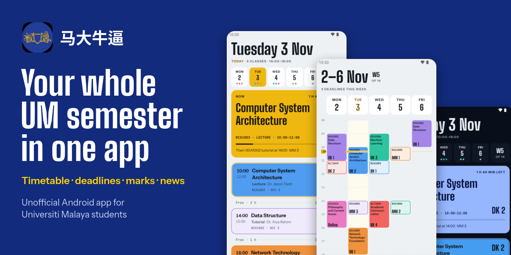
</p>

<p align="center">
  <a href="https://github.com/skylightlim/um-timetable/releases"></a>
  
  
</p>

# 马大牛逼 (UM Timetable)

**A free, unofficial Android app for Universiti Malaya students.** Sign in once with your SiswaMail, and your timetable, Spectrum deadlines, course news and marks are all in one place.

Aplikasi jadual waktu tidak rasmi untuk pelajar UM · 马来亚大学学生的非官方课表应用

### [⬇️ Download the app](https://github.com/skylightlim/um-timetable/releases)

<p align="center">
  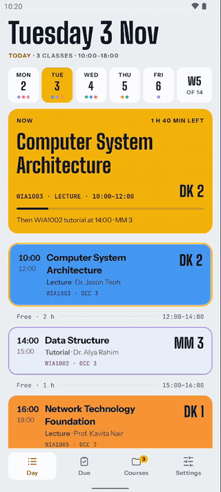
</p>

## What you get

| | |
|---|---|
| **Know what's next** | Your class right now, how long is left, and where to go after it. |
| **See your whole week** | A clean week grid with UM's semester weeks and Kuala Lumpur's public holidays. Add your own plans to free slots. |
| **Never miss a deadline** | Every Spectrum deadline in one list, counting down. |
| **Keep up with each course** | News, marks, files and links, without digging through Spectrum. |
| **Get reminded** | Notifications for deadlines, marks, news, new slides and notes, and your classes. |
| **Check it at a glance** | A home-screen widget with your next class and your week. |
| **Make it yours** | Gold, Blue or Red themes, light and dark. |

## See it

<table>
  <tr>
    <td align="center">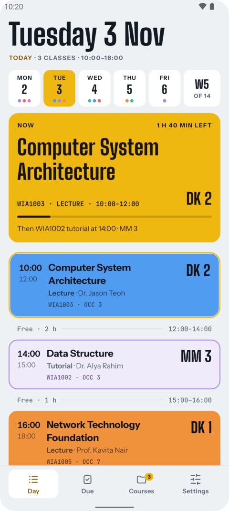<br><b>Day</b></td>
    <td align="center">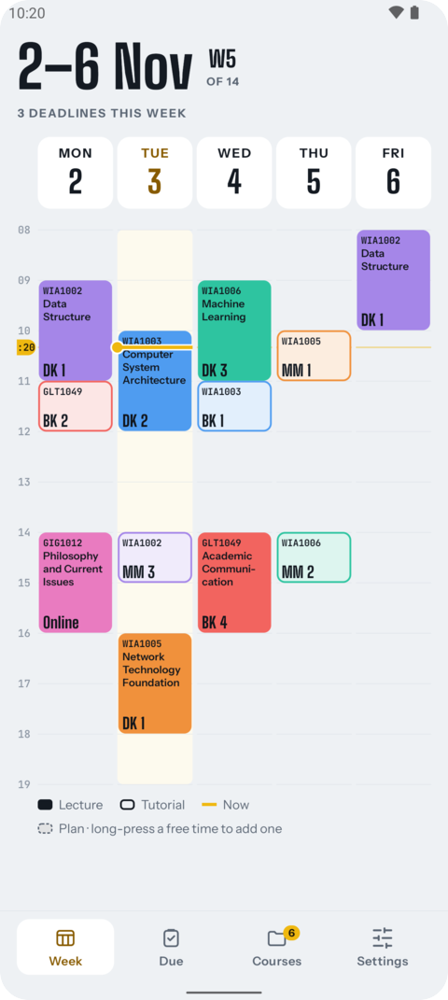<br><b>Week</b></td>
    <td align="center">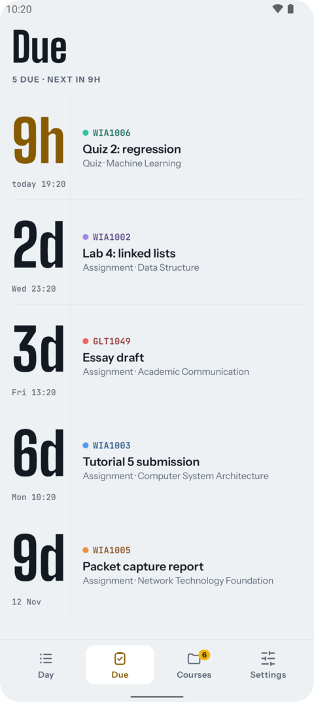<br><b>Due</b></td>
  </tr>
  <tr>
    <td align="center">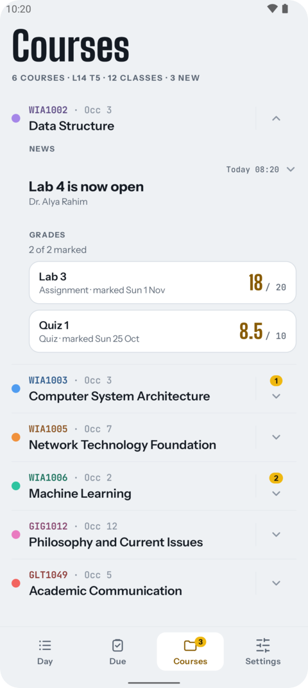<br><b>Courses</b></td>
    <td align="center">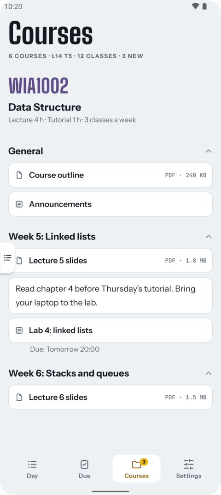<br><b>A course page</b></td>
    <td align="center">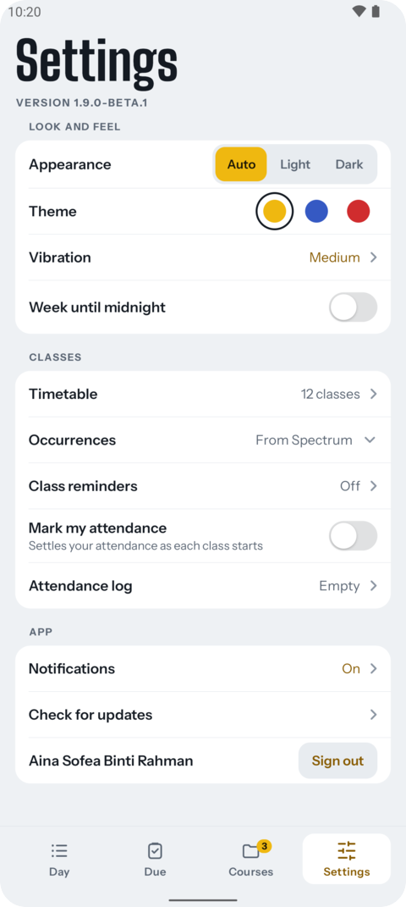<br><b>Settings</b></td>
  </tr>
  <tr>
    <td align="center">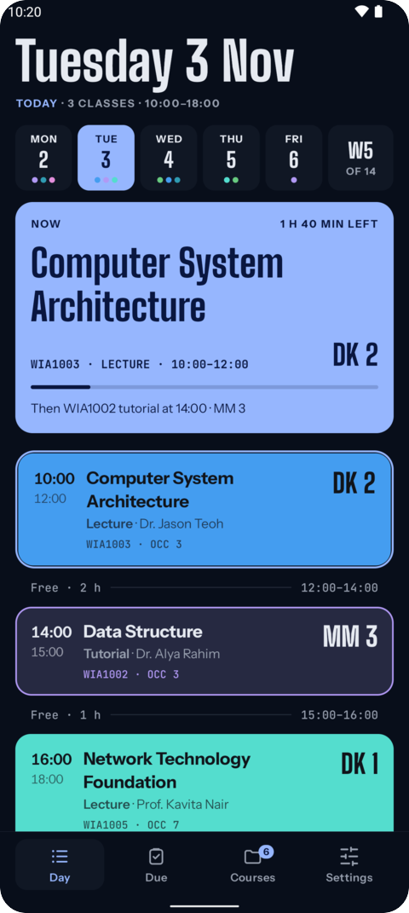<br><b>Dark, in Blue</b></td>
    <td align="center">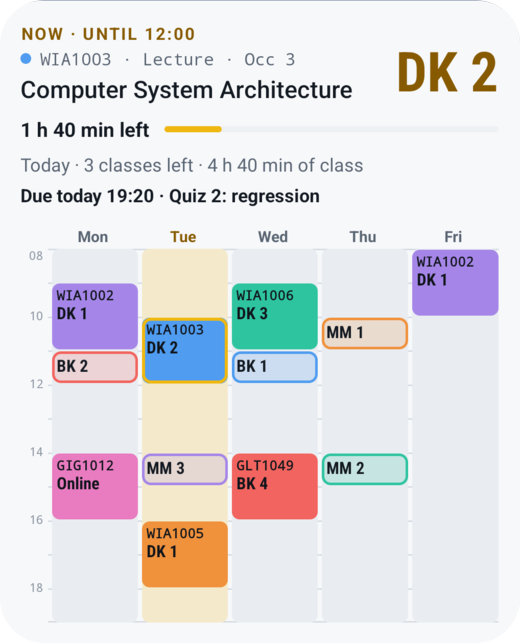<br><b>Widget</b></td>
    <td align="center">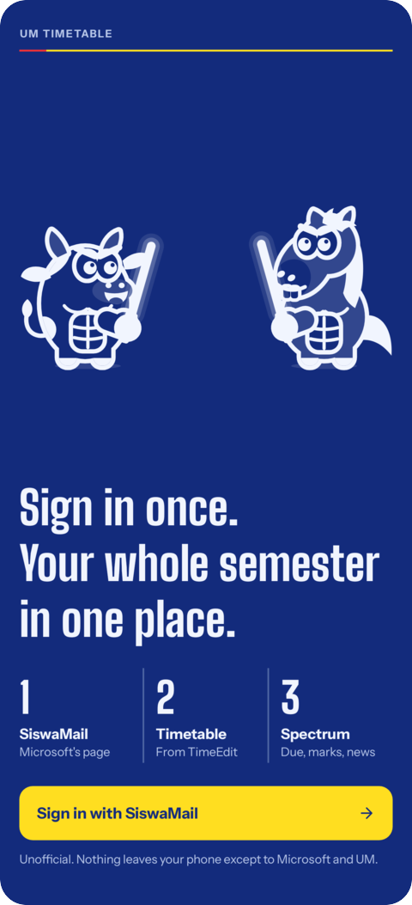<br><b>One sign-in</b></td>
  </tr>
</table>

<sub>Every name, class and mark above is made up: no real student's data is shown.</sub>

## Install it

You need an Android phone on **Android 12 or newer**. There's no iPhone version.

1. Open the [Releases page](https://github.com/skylightlim/um-timetable/releases) on your phone.
2. Under the newest version, tap **Assets**, then the file ending in **.apk**.
3. Open the download. If Android asks, allow installs from your browser.
4. If Play Protect says **App scan recommended**, tap **More details**, then **Install without scanning**. It shows this for apps from outside the Play Store.
5. Open the app and sign in with your **SiswaMail**. Your timetable loads by itself.

New versions show up as an update card inside the app, so you only do this once. Expect small updates often.

## Your privacy

There's **no server** behind this app: nothing about you is sent to the project, and there are no ads or analytics.

- **Your password:** you type it on Microsoft's own sign-in page, and the app doesn't read or save it. It keeps only a sign-in token, encrypted on your phone.
- **Your data:** your timetable, marks and news are stored on your phone only.
- **Who the app talks to:** Microsoft to sign in; UM's Spectrum and TimeEdit for your information (and MAYA, only if you choose to import from it); GitHub to check for updates.
- **Signing out** deletes everything the app saved.

The code is all here, so anyone can check.

## Share it with your coursemates

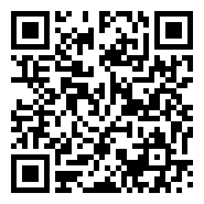

Scan the code, or copy this into your group chat:

```text
马大牛逼: a free UM timetable app. Your classes, Spectrum deadlines,
news and marks in one place, with one SiswaMail sign-in.
No ads, no server. Android 12+.
https://github.com/skylightlim/um-timetable
```

<br clear="right">

## Questions

**Is this an official UM app?** No. It's an independent student project, not made by or connected to Universiti Malaya.

**What does the name mean?** 马大 is the Chinese short name for UM, and 牛逼 is slang for "awesome". You'll see it under the app's icon.

**Can other universities use it?** No. It's built around UM's systems and calendar.

**My timetable looks wrong. What now?** Go to Settings › Timetable and get it again. You can also change a course's occurrence under Settings › Occurrences.

**Something's broken, or you have an idea?** [Open an issue](https://github.com/skylightlim/um-timetable/issues).

## For developers

Plain Android views in Kotlin, with no runtime dependencies. Open `android/` in Android Studio, or:

```sh
cd android
./gradlew testDebugUnitTest assembleDebug
```

[`docs/FINDINGS.md`](docs/FINDINGS.md) explains where UM's data comes from, and [`docs/SPECTRUM-COURSES.md`](docs/SPECTRUM-COURSES.md) how Spectrum's course pages are laid out. Fonts are listed in [`THIRD_PARTY_NOTICES.md`](THIRD_PARTY_NOTICES.md).
